<div align="center">
  
  


Universidad Peruana de Ciencias Aplicadas

Carrera de Ingeniería de Software

**1ASI0732**

**Diseño de Experimentos de Ingeniería de Software**

NRC

**9112**

**Informe del Trabajo Final**

Docente

**Lennin Percy Cenas Vasquez**

Equipo

**HuariApp**

Proyecto

**PuntoSabor**

**Integrantes**

| Código | Apellidos y Nombres |
| --- | --- |
| u20241d995 | Cesar Jair Contreras Rojas |
| u202321843 | Delgado Carrasco, Schneider |
| u202312700 | Lopez Goitia, Carlos Alberto |
| u202411282 | Montalván Palomino, Bruno Rodolfo |
| u202410772 | Razuri Alvarez, Matias Francesco |

**Período 202602**

**Setiembre 2026**

</div>

---

# Registro de versiones del informe

| Versión | Fecha | Autor | Descripción de modificación |
| --- | --- | --- | --- |
|  |  |  |  |
# Project Report Collaboration Insights

**Repositorio de la documentación del proyecto:** https://github.com/HuariApp/puntosabor-report.git

# Informe de Trabajo Final - HuariApp

# Student Outcome

| Criterio específico | Acciones realizadas | Conclusiones |
| --- | --- | --- |
|  |  |  |

# Capítulo I: Introducción

## 1.1. Startup Profile

### 1.1.1. Descripción de la Startup

### 1.1.2. Perfiles de integrantes del equipo

## 1.2. Solution Profile

### 1.2.1. Antecedentes y problemática

### 1.2.2. Lean UX Process

#### 1.2.2.1. Lean UX Problem Statements

#### 1.2.2.2. Lean UX Assumptions

#### 1.2.2.3. Lean UX Hypothesis Statements

#### 1.2.2.4. Lean UX Canvas

## 1.3. Segmentos objetivo

# Capítulo II: Requirements Elicitation & Analysis

## 2.1. Competidores

### 2.1.1. Análisis competitivo

### 2.1.2. Estrategias y tácticas frente a competidores

## 2.2. Entrevistas

### 2.2.1. Diseño de entrevistas

### 2.2.2. Registro de entrevistas

### 2.2.3. Análisis de entrevistas

## 2.3. Needfinding

### 2.3.1. User Personas

### 2.3.2. User Task Matrix

### 2.3.3. User Journey Mapping

### 2.3.4. Empathy Mapping

### 2.3.5. As-is Scenario Mapping

## 2.4. Ubiquitous Language

# Capítulo III: Requirements Specification

## 3.1. To-Be Scenario Mapping

## 3.2. User Stories

## 3.3. Product Backlog

## 3.4. Impact Mapping

# Capítulo IV: Product Design

## 4.1. Style Guidelines

### 4.1.1. General Style Guidelines

### 4.1.2. Web Style Guidelines

### 4.1.3. Mobile Style Guidelines

#### 4.1.3.1. iOS Mobile Style Guidelines

#### 4.1.3.2. Android Mobile Style Guidelines

## 4.2. Information Architecture

### 4.2.1. Organization Systems

### 4.2.2. Labeling Systems

### 4.2.3. SEO Tags and Meta Tags

### 4.2.4. Searching Systems

### 4.2.5. Navigation Systems

## 4.3. Landing Page UI Design

### 4.3.1. Landing Page Wireframe

### 4.3.2. Landing Page Mock-up

## 4.4. Mobile Applications UX/UI Design

### 4.4.1. Mobile Applications Wireframes

### 4.4.2. Mobile Applications Wireflow Diagrams

### 4.4.3. Mobile Applications Mock-ups

### 4.4.4. Mobile Applications User Flow Diagrams

## 4.5. Mobile Applications Prototyping

### 4.5.1. Android Mobile Applications Prototyping

### 4.5.2. iOS Mobile Applications Prototyping

## 4.6. Web Applications UX/UI Design

### 4.6.1. Web Applications Wireframes

### 4.6.2. Web Applications Wireflow Diagrams

### 4.6.3. Web Applications Mock-ups

### 4.6.4. Web Applications User Flow Diagrams

## 4.7. Web Applications Prototyping

## 4.8. Domain-Driven Software Architecture

### 4.8.1. Software Architecture Context Diagram

### 4.8.2. Software Architecture Container Diagrams

### 4.8.3. Software Architecture Components Diagrams

## 4.9. Software Object-Oriented Design

### 4.9.1. Class Diagrams

### 4.9.2. Class Dictionary

## 4.10. Database Design

### 4.10.1. Relational/Non-Relational Database Diagram

# Capítulo V: Product Implementation

## 5.1. Software Configuration Management

### 5.1.1. Software Development Environment Configuration

### 5.1.2. Source Code Management

### 5.1.3. Source Code Style Guide & Conventions

### 5.1.4. Software Deployment Configuration

## 5.2. Product Implementation & Deployment

### 5.2.1. Sprint Backlogs

### 5.2.2. Implemented Landing Page Evidence

### 5.2.3. Implemented Frontend-Web Application Evidence

### 5.2.4. Acuerdo de Servicio - SaaS

### 5.2.5. Implemented Native-Mobile Application Evidence

### 5.2.6. Implemented RESTful API and/or Serverless Backend Evidence

### 5.2.7. RESTful API documentation

### 5.2.8. Team Collaboration Insights

## 5.3. Video About-the-Product

# Capítulo VI: Product Verification & Validation

## 6.1. Testing Suites & Validation

### 6.1.1. Core Entities Unit Tests

Se implementaron pruebas unitarias para las entidades del dominio que concentran 
lógica de negocio propia, aislándolas de la base de datos y de servicios externos. 
Se priorizaron las propiedades calculadas `Promo.IsActive` y `Subscription.IsActive`, 
que determinan la vigencia de promociones y membresías respectivamente.

**Framework:** xUnit (.NET 8)
**Patrón aplicado:** AAA (Arrange-Act-Assert / Preparar-Ejecutar-Verificar)

| # | Clase | Comportamiento probado |
|---|---|---|
| 1 | `Promo` | `IsActive` true cuando está dentro de rango y con cupos disponibles |
| 2 | `Promo` | `IsActive` false cuando ya expiró |
| 3 | `Promo` | `IsActive` false cuando aún no comienza |
| 4 | `Promo` | `IsActive` false cuando se agotaron los cupos |
| 5 | `Promo` | `IsActive` ignora el límite cuando `MaxUses` es nulo |
| 6 | `Subscription` | `IsActive` true si está activa y sin vencimiento |
| 7 | `Subscription` | `IsActive` false si el status es `cancelled` |

Las 7 pruebas se ejecutaron satisfactoriamente (7/7 superadas, 0 con error):

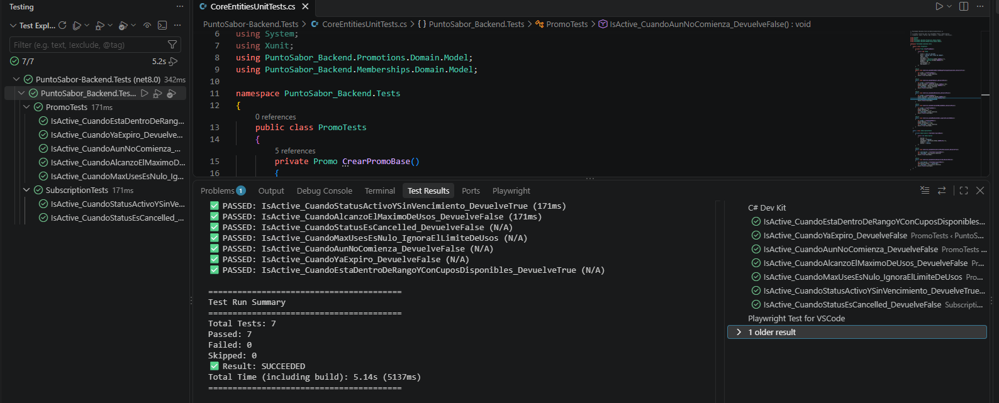

**Repositorio:** https://github.com/HuariqueHub/PuntoSabor-Backend (carpeta `PuntoSabor-Backend.Tests`)

| Repository | Branch | Commit Id | Commit Message | Commited on |
|---|---|---|---|---|
| PuntoSabor-Backend | feature/unit-tests-core-entities | `c421528` | `test: add unit tests for Promo and Subscription IsActive` | 05/10/2026 |

### 6.1.2. Core Integration Tests

Se implementaron pruebas de integración para validar las reglas de negocio clave (*Business Rules*) que involucran la interacción directa con la base de datos relacional y las restricciones de integridad entre entidades. Las pruebas se ejecutaron sobre un motor de base de datos en memoria (**SQLite In-Memory**), permitiendo validar persistencia, unicidad y consultas complejas en un entorno aislado, controlado y de rápida ejecución.

**Framework:** xUnit (.NET 8)  
**Motor DB de Prueba:** Microsoft.Data.Sqlite (In-Memory)  
**Patrón aplicado:** AAA (Arrange-Act-Assert / Preparar-Ejecutar-Verificar)

| # | Regla de Negocio | Comportamiento probado |
|---|---|---|
| 1 | `BR-01` | Prevención de reseñas duplicadas: lanza `InvalidOperationException` si el mismo usuario intenta publicar más de una reseña en el mismo huarique. |
| 2 | `BR-02` | Control de cancelación SaaS: verifica que una membresía con estado `cancelled` permanezca con beneficios activos (`IsActive = true`) hasta alcanzar su fecha de vencimiento (`EndDate`). |
| 3 | `BR-03` | Límite único de favoritos: garantiza que la combinación `UserId` y `HuariqueId` no se duplique en la base de datos al intentar agregar un favorito existente. |
| 4 | `BR-04` | Control de cupos en promociones: verifica que una promoción con `CurrentUses` igual a `MaxUses` pase automáticamente a `IsActive = false` y sea excluida del listado de promociones vigentes. |

Las 4 pruebas de integración se ejecutaron satisfactoriamente (4/4 superadas, 0 con error):

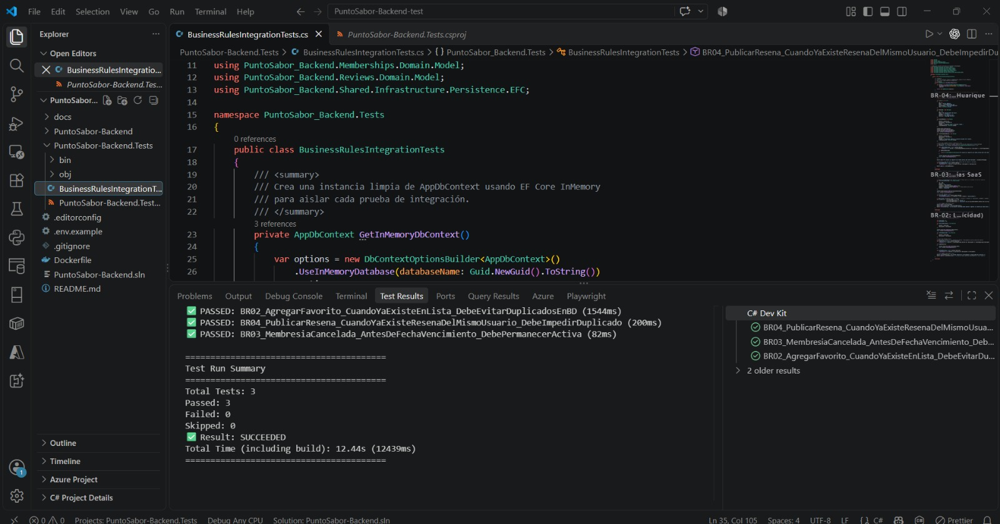

**Repositorio:** https://github.com/HuariqueHub/PuntoSabor-Backend (carpeta `PuntoSabor-Backend.Tests`)

| Repository | Branch | Commit Id | Commit Message | Commited on |
|---|---|---|---|---|
| PuntoSabor-Backend | main | `afb5b57` | `test: add integration tests for core business rules (BR-01 to BR-04)` | 06/10/2026 |

### 6.1.3. Core Behavior-Driven Development

Para esta sección se seleccionaron 10 escenarios de prueba basados en el enfoque **Behavior-Driven Development**, formalizando los criterios de aceptación ya definidos en las User Stories de la sección 3.2, siguiendo la estructura estándar **Given / When / Then**. Se priorizó al menos un escenario representativo por cada Epic relevante del proyecto, cubriendo los distintos roles involucrados como Usuario explorador, Dueño de huarique, Sistema y Visitante. Se emplea Scenario Outline con tablas Examples cuando varios casos comparten la misma estructura, siguiendo las buenas prácticas de BDD para que los escenarios sean directamente automatizables.

### Escenario 1 — Registrar e iniciar sesión de forma segura
**User Story:** US15 | **Epic:** EP07 — Autenticación y gestión de cuenta
 
```gherkin
Feature: Autenticación de usuario
  Como usuario
  Quiero crear una cuenta e iniciar sesión con credenciales seguras
  Para acceder a mi perfil y a las funciones personalizadas de PuntoSabor
 
  Scenario Outline: Inicio de sesión con distintas credenciales
    Given que existe una cuenta registrada con el correo "carla.dipes@gmail.com" y contraseña "Sazon2026!"
    When el usuario ingresa el correo "<correo>" y la contraseña "<contrasena>"
    Then el sistema responde con "<resultado>"
 
    Examples:
      | correo                  | contrasena   | resultado                                  |
      | carla.dipes@gmail.com   | Sazon2026!   | acceso concedido y redirección a Home      |
      | carla.dipes@gmail.com   | ClaveMala123 | mensaje de error "Credenciales incorrectas"|
      | nuevo@gmail.com         | Sazon2026!   | mensaje de error "Usuario no registrado"   |
```
---
 
### Escenario 2 — Filtrar huariques
**User Story:** US01 | **Epic:** EP01 — Descubrimiento de huariques
 
```gherkin
Feature: Filtrado de huariques
  Como usuario
  Quiero filtrar huariques por tipo de comida y rango de precio
  Para encontrar opciones acordes a mis preferencias
 
  Background:
    Given que existen los siguientes huariques registrados:
      | nombre          | categoria  | distrito      | precio |
      | El Costeño      | Marina     | San Miguel    | 25     |
      | Sabor Norteño   | Pollería   | Jesús María   | 18     |
      | La Brasa de Oro | Pollería   | Lince         | 22     |
 
  Scenario Outline: Búsqueda combinando categoría y precio máximo
    When el usuario filtra por categoría "<categoria>" y precio máximo "<precio_max>"
    Then el sistema muestra únicamente "<resultado_esperado>"
 
    Examples:
      | categoria | precio_max | resultado_esperado          |
      | Marina    | 30         | El Costeño                  |
      | Pollería  | 20         | Sabor Norteño                |
      | Criolla   | 50         | ningún resultado encontrado |
```
 
---
### Escenario 3 — Visualizar huariques en mapa
**User Story:** US02 | **Epic:** EP01 — Descubrimiento de huariques
 
```gherkin
Feature: Visualización en mapa
  Como usuario
  Quiero visualizar la ubicación de los huariques en un mapa
  Para identificar fácilmente cómo llegar a ellos
 
  Scenario: Selección de un marcador en el mapa
    Given que el huarique "El Costeño" está ubicado en el distrito San Miguel con calificación 4.5
    And su marcador es visible en el mapa de la sección Explore
    When el usuario hace clic sobre el marcador de "El Costeño"
    Then el sistema muestra un popup con el nombre "El Costeño", la dirección registrada y la calificación "4.5"
```
 
---
 
### Escenario 4 — Registrar un nuevo huarique
**User Story:** US04 | **Epic:** EP02 — Gestión de huariques
 
```gherkin
Feature: Registro de huarique
  Como dueño
  Quiero registrar un nuevo huarique con información básica
  Para que aparezca en la plataforma
 
  Scenario Outline: Registro de huarique con datos completos o incompletos
    Given que el dueño "Luis Pérez" completa el formulario con nombre "<nombre>", categoría "<categoria>" y dirección "<direccion>"
    When envía el formulario de registro
    Then el sistema responde con "<resultado>"
 
    Examples:
      | nombre      | categoria | direccion                  | resultado                                           |
      | Don Luis    | Criolla   | Jr. Las Magnolias 452      | huarique registrado y visible en Explore            |
      | Don Luis    | Criolla   | (vacío)                    | mensaje "Completa la dirección antes de continuar"  |
      | (vacío)     | Criolla   | Jr. Las Magnolias 452      | mensaje "El nombre del huarique es obligatorio"     |
```
 
---
 
### Escenario 5 — Publicar reseñas
**User Story:** US07 | **Epic:** EP03 — Reseñas y calificaciones
 
```gherkin
Feature: Publicación de reseñas
  Como usuario
  Quiero publicar una reseña y calificación sobre un huarique
  Para compartir mi experiencia con otros usuarios
 
  Scenario: Publicación exitosa de una reseña
    Given que el usuario "Carla Dipes" visitó el huarique "El Costeño" y no lo ha reseñado antes
    When publica la reseña "Excelente ceviche, muy fresco" con calificación de 5 estrellas
    Then el sistema agrega la reseña al perfil de "El Costeño"
    And el rating promedio del huarique se recalcula incluyendo la nueva calificación
 
  Scenario: Intento de reseña duplicada
    Given que "Carla Dipes" ya publicó una reseña sobre "El Costeño"
    When intenta publicar una segunda reseña sobre el mismo huarique
    Then el sistema muestra el mensaje "Ya has reseñado este huarique" y no crea un registro nuevo
```
 
---
 
### Escenario 6 — Moderar reseñas inapropiadas
**User Story:** US08 | **Epic:** EP03 — Reseñas y calificaciones
 
```gherkin
Feature: Moderación automática de reseñas
  Como sistema
  Quiero detectar reseñas con lenguaje ofensivo
  Para evitar contenido ofensivo dentro de la plataforma
 
  Scenario Outline: Moderación según el contenido de la reseña
    When un usuario intenta publicar la reseña "<texto_reseña>"
    Then el sistema responde con "<resultado>"
 
    Examples:
      | texto_reseña                                   | resultado                                  |
      | "La comida llegó fría pero el sabor es bueno"  | reseña publicada sin restricciones          |
      | "Este lugar es una basura y el dueño un [insulto]" | reseña bloqueada y marcada para revisión |
```
 
---
 
### Escenario 7 — Convertir visitante en usuario registrado desde la Landing Page
**User Story:** US09 / US10 | **Epic:** EP04 — Landing Page
 
```gherkin
Feature: Conversión de visitante a usuario registrado
  Como visitante
  Quiero conocer los beneficios de PuntoSabor y registrarme sin fricción
  Para empezar a usar la plataforma como explorador o como dueño de huarique
 
  Scenario: El visitante revisa los planes y decide registrarse como dueño
    Given que el visitante accede a la landing page y revisa la sección "Planes para tu negocio"
    When hace clic en "Empezar gratis" del plan Básico
    Then el sistema abre el modal de registro con el rol "Dueño" preseleccionado
 
  Scenario: El visitante envía una consulta sin completar todos los campos
    Given que el visitante abre el formulario de contacto
    When envía el formulario dejando el campo "correo" vacío
    Then el sistema muestra el mensaje "Completa tu correo para poder contactarte" y no envía la consulta
```
 
---
 
### Escenario 8 — Seleccionar planes de membresía
**User Story:** US23 | **Epic:** EP10 — Membresías, pagos y promociones
 
```gherkin
Feature: Selección de plan de membresía
  Como dueño
  Quiero elegir entre planes de membresía con distintos beneficios
  Para aumentar la visibilidad de mi huarique
 
  Scenario Outline: Activación de un plan de membresía
    Given que el dueño "Luis Pérez" tiene actualmente el plan "<plan_actual>"
    When selecciona y confirma el plan "<plan_nuevo>" con precio "<precio>"
    Then el sistema activa el plan "<plan_nuevo>" para su huarique
 
    Examples:
      | plan_actual | plan_nuevo | precio |
      | Básico      | Premium    | $35    |
      | Premium     | Exclusivo  | $50    |
```
 
---
 
### Escenario 9 — Pagar suscripción
**User Story:** US24 | **Epic:** EP10 — Membresías, pagos y promociones
 
```gherkin
Feature: Pago de suscripción
  Como dueño
  Quiero pagar mi membresía mediante tarjeta o billetera digital
  Para mantener activo mi plan
 
  Scenario Outline: Resultado del pago según los datos ingresados
    Given que el dueño selecciona el plan "Premium" con precio "$35"
    When ingresa los datos de pago "<datos_tarjeta>"
    Then el sistema responde con "<resultado>"
 
    Examples:
      | datos_tarjeta                                | resultado                                              |
      | tarjeta 4111 1111 1111 1111, vigente, CVV 123 | pago registrado y suscripción Premium activada         |
      | tarjeta 4111 1111 1111 1111, vencida 01/24    | mensaje "Tarjeta vencida" y suscripción no activada    |
      | número de tarjeta incompleto                  | mensaje "Verifica los datos de tu tarjeta"             |
```
 
---
 
### Escenario 10 — Reportar y corregir información incorrecta
**User Story:** US21 | **Epic:** EP09 — Información y estado del huarique
 
```gherkin
Feature: Reporte de información incorrecta
  Como usuario
  Quiero reportar datos incorrectos de un huarique
  Para contribuir a mantener actualizada la información
 
  Scenario: Un usuario registra un reporte sobre un horario incorrecto
    Given que el huarique "Sabor Norteño" muestra el horario "08:00 - 16:00"
    When el usuario reporta que "el horario real es 08:00 - 20:00" con motivo "Horario desactualizado"
    Then el sistema crea el reporte con estado "pending" asociado a "Sabor Norteño"
 
  Scenario: El equipo revisa y corrige el reporte previamente registrado
    Given que existe un reporte en estado "pending" sobre el huarique "Sabor Norteño" indicando el horario correcto "08:00 - 20:00"
    When el equipo revisa el reporte y actualiza el horario del huarique
    Then el estado del reporte cambia a "reviewed"
    And el perfil de "Sabor Norteño" muestra el horario "08:00 - 20:00" a los usuarios
```

### 6.1.4. Core System Tests

Para esta sección se automatizaron 4 de los 10 escenarios definidos en el
documento BDD (6.1.3), con un total de 7 casos de prueba, priorizando los
flujos más críticos del sistema: autenticación, búsqueda, publicación de
contenido y pagos. Se utilizó **Playwright** como framework de automatización,
combinando el grabador (Codegen) para capturar las interacciones reales sobre
el Front desplegado en producción (`https://punto-sabor-front.vercel.app`) con
verificaciones (`expect`) escritas manualmente para validar los resultados
esperados. El código de las pruebas está en la carpeta `e2e-tests/` del
repositorio del Front.

### Configuración del entorno

Las pruebas se ejecutan con `npx playwright test --project=chromium`.

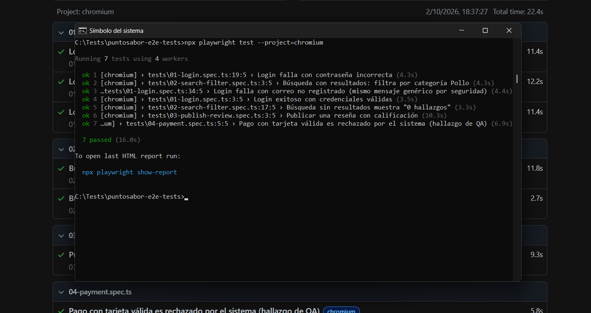

### Escenario 1 — Autenticación

Se probaron 3 casos: login exitoso, contraseña incorrecta y correo no
registrado.

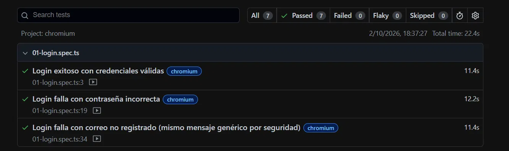

### Escenario 2 — Búsqueda y filtrado

Se probaron 2 casos: la búsqueda "Pollo" muestra resultados de esa categoría y
una búsqueda sin coincidencias muestra "0 hallazgos".

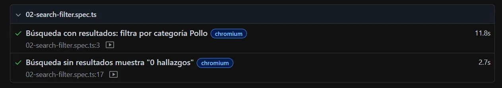

### Escenario 5 — Publicación de reseñas

El usuario inicia sesión, elige el rol Explorer, busca "Pollo", publica una
reseña de 5 estrellas con comentario y se verifica que aparece en el listado
del huarique.

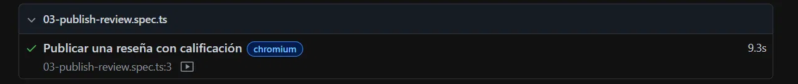

### Escenario 9 — Pago de suscripción

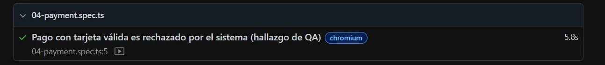

La prueba recorre el flujo grabado completo (inicio de sesión, elección de rol,
planes, "Choose Premium", datos de tarjeta y pago) y verifica el mensaje
"Payment Successful!", la activación de la membresía y el ID de transacción.
Requiere una cuenta sin suscripción previa.

**Observación:** si la cuenta ya tiene una suscripción activa, el pago falla en
la versión desplegada al momento de las pruebas (`PATCH` no soportado por el
backend, HTTP 405); la corrección se encuentra en revisión (PR #1 del Front).

### Evidencia de ejecución

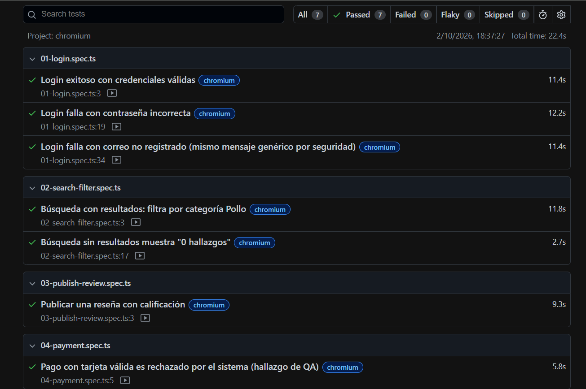

Adicionalmente, se automatizó el flujo de autenticación de la aplicación
móvil (5 casos) con Jetpack Compose UI Test, sobre el emulador de Android
Studio.

Se automatizó el flujo de autenticación de la app para dueños con
**Jetpack Compose UI Test**, ejecutado en el emulador de Android Studio
(Medium Phone, API 37) contra el backend desplegado en Railway. El código está
en `app/src/androidTest/` del repositorio de la app.

| N.° | Caso | Resultado esperado |
|---|---|---|
| 1 | Campos vacíos | Muestra "Por favor completa todos los campos" |
| 2 | Contraseña corta | Muestra "La contraseña debe tener al menos 6 caracteres" |
| 3 | Contraseña incorrecta | Muestra el error de credenciales del backend |
| 4 | Cuenta de explorador | Muestra "Esta app es para dueños" |
| 5 | Cuenta de dueño | Navega al panel "Mi Panel" |

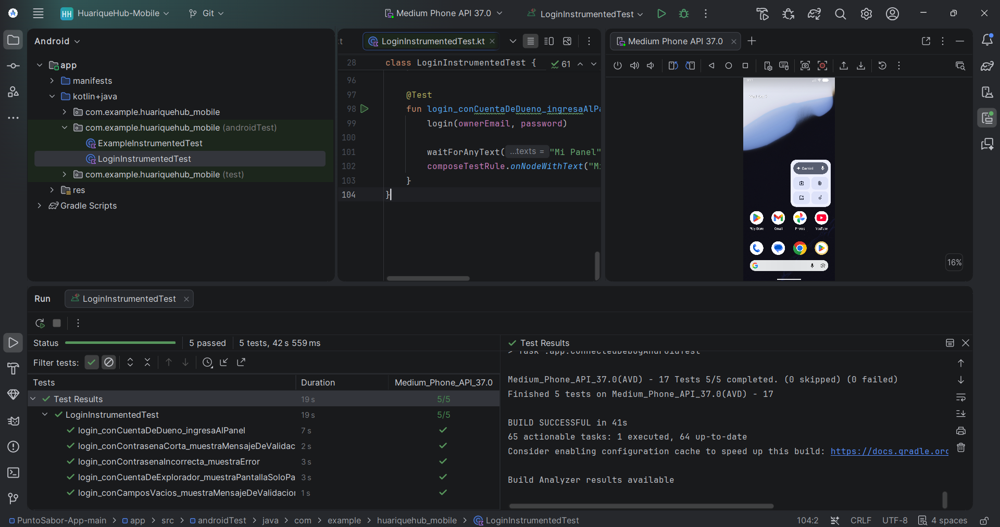

## 6.2. Static testing & Verification

### 6.2.1. Static Code Analysis

#### 6.2.1.1. Coding standard & Code conventions

Se corrió `dotnet format --verify-no-changes` sobre el proyecto `PuntoSabor-Backend` para verificar el cumplimiento del `.editorconfig` del repositorio (charset UTF-8, finales de línea CRLF, indentación de 4 espacios y newline final obligatorio).

El resultado arrojó 527 violaciones en 49 archivos: 488 de indentación/espaciado (WHITESPACE) y 39 de archivos sin salto de línea final (FINALNEWLINE). La mayoría se concentra en archivos poco modificados desde su creación, en especial `DataSeeder.cs` con 358 violaciones, el 68% del total. Le siguen `PromosController.cs` (28), `HuariqueRepository.cs` (27), `AuthController.cs` (18) y `HuariquesController.cs` (14); el resto de archivos tiene entre 1 y 6 violaciones, casi todas en comentarios de documentación XML. Los archivos de pruebas agregados en la sección 6.1 no presentan ninguna, porque se escribieron ya respetando el formato configurado.

Son correcciones mecánicas que no afectan la lógica del sistema, así que quedan pendientes para un commit de formateo aparte, sin mezclarlas con cambios funcionales.

Las convenciones de nomenclatura y la organización en capas (PascalCase, separación Domain/Application/Infrastructure/Presentation, Conventional Commits) ya estaban definidas desde la sección 5.1.3; esta verificación se limitó al formato automático.

#### 6.2.1.2. Code Quality & Code Security

El proyecto no tenía ningún analizador de calidad configurado (ni StyleCop.Analyzers ni SonarAnalyzer.CSharp), por lo que se habilitaron los analizadores de Roslyn agregando `<EnableNETAnalyzers>true</EnableNETAnalyzers>` y `<AnalysisLevel>latest-recommended</AnalysisLevel>` en `PuntoSabor-Backend.csproj`.

Antes de esto, `dotnet build` solo marcaba un warning real: `EF1002`, detallado abajo. Con `latest-recommended` activo, el build pasó a 52 warnings, la mayoría de APIs sensibles a cultura (`CA1305`, `CA1304`, `CA1311`), namespaces que chocan con palabras reservadas (`CA1716`), inicializadores redundantes (`CA1805`) y sugerencias de comparación de strings (`CA1862`). Ninguno es un riesgo de seguridad, quedan como deuda técnica documentada.

**Hallazgo de seguridad: SQL Injection (EF1002)**

El analizador detectó que `SchemaInitializer.cs` construía una sentencia DDL interpolando directamente nombres de tabla y columna:

```csharp
// Antes
context.Database.ExecuteSqlRaw($"ALTER TABLE `{table}` ADD COLUMN `{column}` {definition}");
```

La parametrización que sugiere EF1002 no aplica acá: MySQL no permite enlazar un parámetro en la posición de un nombre de tabla o columna en DDL. Se validan los identificadores contra un patrón estricto antes de interpolarlos y se suprime el warning puntualmente:

```csharp
// Después
ValidateIdentifier(table);
ValidateIdentifier(column);
#pragma warning disable EF1002
context.Database.ExecuteSqlRaw($"ALTER TABLE `{table}` ADD COLUMN `{column}` {definition}");
#pragma warning restore EF1002

private static void ValidateIdentifier(string identifier)
{
    if (!Regex.IsMatch(identifier, "^[A-Za-z_][A-Za-z0-9_]*$"))
        throw new ArgumentException($"Identificador SQL inválido: '{identifier}'.", nameof(identifier));
}
```

**Vulnerabilidades en dependencias**

`dotnet list package --vulnerable --include-transitive` encontró 4 paquetes transitivos con severidad High, ninguno declarado directamente en el `.csproj`:

| Paquete transitivo | Versión | Severidad | Advisory |
|---|---|---|---|
| Microsoft.Extensions.Caching.Memory | 8.0.0 | High | GHSA-qj66-m88j-hmgj |
| System.Net.Http | 4.3.0 | High | GHSA-7jgj-8wvc-jh57 |
| System.Text.Json | 8.0.3 | High (x2) | GHSA-hh2w-p6rv-4g7w, GHSA-8g4q-xg66-9fp4 |
| System.Text.RegularExpressions | 4.3.0 | High | GHSA-cmhx-cq75-c4mj |

Llegan de forma transitiva, probablemente desde versiones antiguas de `MySql.EntityFrameworkCore` y `Swashbuckle.AspNetCore`. Quedan pendientes de remediación, porque fijar versiones mínimas seguras requiere antes verificar compatibilidad.

Build final: 51 warnings (deuda técnica documentada), 0 errores, 30/30 pruebas unitarias pasando.

**Repositorio:** https://github.com/HuariApp/PuntoSabor-Backend

| Repository | Branch | Commit Id | Commit Message | Commited on |
|---|---|---|---|---|
| PuntoSabor-Backend | feature/static-code-analysis | `998cef2` | `chore: enable .NET analyzers with latest-recommended level` | 09/11/2026 |
| PuntoSabor-Backend | feature/static-code-analysis | `0606ac9` | `fix: validate identifiers before interpolating DDL in SchemaInitializer` | 09/11/2026 |

### 6.2.2. Reviews

## 6.3. Validation Interviews

### 6.3.1. Diseño de Entrevistas

Para llevar a cabo las entrevistas de validación de concepto y usabilidad del proyecto **PuntoSabor**, se diseñó una guía estructurada orientada a evaluar la percepción de valor, la claridad de la interfaz y la intención de uso en dos segmentos clave de usuarios. 

#### **Segmento 1: Explorador gastronómico**
Este segmento está compuesto por usuarios que buscan descubrir huariques, restaurantes locales o lugares de comida auténtica mediante herramientas digitales.

**Preguntas realizadas:**
1. Después de ver la aplicación, ¿crees que PuntoSabor te ayudaría a encontrar huariques de manera más sencilla?
2. ¿La pantalla principal te parece clara y fácil de entender?
3. ¿Consideras útil poder buscar huariques por categorías, nombre o preferencias?
4. ¿La información mostrada en el detalle del huarique, como fotos, horarios, ubicación, reseñas y estado de apertura, te parece suficiente para decidir si visitarías el local?
5. ¿Qué opinas sobre la posibilidad de guardar huariques favoritos?
6. ¿Las promociones o recomendaciones te motivarían a usar la aplicación con mayor frecuencia?
7. ¿Qué aspecto de la aplicación te gustó más?
8. ¿Qué mejorarías para que la experiencia sea más completa?
9. ¿Recomendarías PuntoSabor a otras personas interesadas en descubrir huariques? ¿Por qué?
10. ¿Qué tan confiables o útiles te parecen las reseñas y fotos mostradas en comparación con lo que sueles ver en otras plataformas o redes sociales?
11. Al interactuar con la búsqueda y los filtros, ¿hubo alguna información o botón que esperabas encontrar y no estaba a la vista?
12. ¿En qué momento o situación de tu semana te imaginas abriendo PuntoSabor por primera vez?

---

#### **Segmento 2: Dueño o administrador de huarique**
Este segmento está compuesto por propietarios o encargados de negocios gastronómicos locales que buscan aumentar su visibilidad digital y atraer más clientes.

**Preguntas realizadas:**
1. Después de ver la aplicación, ¿crees que PuntoSabor podría ayudarte a promocionar tu huarique o negocio?
2. ¿Te parece clara la forma en que se muestra la información del huarique?
3. ¿Consideras útil poder mostrar horarios, estado de apertura, ubicación, fotos y reseñas del negocio?
4. ¿Qué opinas sobre las promociones y planes de membresía dentro de la aplicación?
5. ¿Crees que esta plataforma podría ayudarte a atraer nuevos clientes?
6. ¿La aplicación te parece fácil de entender para un dueño de huarique?
7. ¿Qué funcionalidad te parece más útil para tu negocio?
8. ¿Qué mejorarías para que la aplicación sea más práctica para los propietarios?
9. ¿Estarías dispuesto a usar PuntoSabor para dar mayor visibilidad a tu negocio? ¿Por qué?
10. ¿Qué tan sencillo te resultaría actualizar periódicamente tus platos del día, promociones u horarios desde el panel de administración visto?
11. ¿Qué información sobre los clientes que visitan o buscan tu negocio te gustaría ver dentro de la aplicación para medir si la plataforma te está funcionando?
12. ¿Qué duda o temor te surgiría al momento de evaluar contratar un plan de membresía o promoción pagada en la plataforma?

---

### 6.3.2. Registro de Entrevistas

A continuación se resumen los registros y evidencias cualitativas recolectadas durante la ejecución de las sesiones de entrevista con representantes de ambos segmentos.

#### **Registro de Entrevistas - Segmento 1: Explorador Gastronómico**

| Campo | Detalle |
| --- | --- |
| **Nombre entrevistado** |  |
| **Edad** |  |
| **Departamento / Distrito** |  |
| **Inicio del video** |  |
| **Fin del video** |  |
| **Duración** |  |
| **Link del video** |  |
| **Foto entrevista** |  |
| **Resumen** |  |

| Campo | Detalle |
| --- | --- |
| **Nombre entrevistado** |  |
| **Edad** |  |
| **Departamento / Distrito** |  |
| **Inicio del video** |  |
| **Fin del video** |  |
| **Duración** |  |
| **Link del video** |  |
| **Foto entrevista** |  |
| **Resumen** |  |

#### **Registro de Entrevistas - Segmento 2: Dueño o administrador de huarique**

| Campo | Detalle |
| --- | --- |
| **Nombre entrevistado** |  |
| **Edad** |  |
| **Departamento / Distrito** |  |
| **Inicio del video** |  |
| **Fin del video** |  |
| **Duración** |  |
| **Link del video** |  |
| **Foto entrevista** |  |
| **Resumen** |  |

| Campo | Detalle |
| --- | --- |
| **Nombre entrevistado** |  |
| **Edad** |  |
| **Departamento / Distrito** |  |
| **Inicio del video** |  |
| **Fin del video** |  |
| **Duración** |  |
| **Link del video** |  |
| **Foto entrevista** |  |
| **Resumen** |  |

---

### 6.3.3. Evaluaciones según heurísticas

Para analizar sistemáticamente las respuestas obtenidas en las entrevistas, se definieron y aplicaron 3 heurísticas metodológicas de evaluación cualitativa:

1. **Heurística 1: Claridad y Usabilidad Percibida (Nielsen #2 y #4)**
   * **Definición:** Evalúa la facilidad con la que el usuario comprende la interfaz, la jerarquía visual de la información (horarios, ubicación, menús) y la navegabilidad sin requerir esfuerzo cognitivo adicional.
   * **Análisis de Resultados (Segmento 1):** Los usuarios señalaron que la pantalla principal y las fichas de detalle son intuitivas. La inclusión visual de badges como "Abierto/Cerrado" reduce dudas inmediatas. Se identificó la necesidad de mantener filtros visibles desde la pantalla de inicio.
   * **Análisis de Resultados (Segmento 2):** Los administradores entendieron la estructura de la información expuesta. Solicitaron interfaces extremadamente simplificadas para la actualización de menús diarios.

2. **Heurística 2: Propuesta de Valor y Relevancia de Negocio (Utility & Desirability)**
   * **Definición:** Mide si las funcionalidades presentadas (promociones, guardado de favoritos, estado de apertura, visibilidad comercial y membresías) resuelven necesidades reales de forma superior a las alternativas actuales.
   * **Análisis de Resultados (Segmento 1):** La posibilidad de descubrir huariques no comerciales mediante recomendaciones categorizadas aporta valor directo. Las promociones actúan como un incentivador clave para incrementar la frecuencia de uso de la aplicación.
   * **Análisis de Resultados (Segmento 2):** Atraer nuevos clientes a través de la digitalización resuelve una de las mayores frustraciones del segmento. El interés en planes de membresía depende de la inclusión de métricas claras de visualizaciones y visitas.

3. **Heurística 3: Adopción y Fricción de Uso (Adoption Barrier Analysis)**
   * **Definición:** Analiza la disposición del usuario a incorporar PuntoSabor en su rutina diaria o flujo de trabajo, identificando temores, dudas o fricciones que impidan la recomendación o permanencia en la plataforma.
   * **Análisis de Resultados (Segmento 1):** La principal fricción identificada es la desconfianza ante reseñas manipuladas o desactualizadas; los usuarios demandan verificar opiniones y fotos reales hechas por la misma comunidad.
   * **Análisis de Resultados (Segmento 2):** El temor recurrente radica en la complejidad o el tiempo que requiera mantener actualizada la información del local en la plataforma. Asegurar un panel de administración rápido y ágil es condición clave para lograr la adopción continua del comercio.

## 6.4. Auditoría de Experiencias de Usuario

### 6.4.1. Auditoría realizada

#### 6.4.1.1. Información del grupo auditado

| Campo | Detalle |
| :--- | :--- |
| **Nombre de la Startup (Auditada)** | Bananawire |
| **Nombre del Producto (Auditado)** | Clair |
| **Integrante 1** | Aleman Romano, Dante Mateo (u202319963) |
| **Integrante 2** | Barturen, Iker (u202319025) |
| **Integrante 3** | Huaco Oliva, Luis Alonso (u202417743) |
| **Integrante 4** | Ortiz Alarcon, Victor Nicolas (u202312899) |
| **Integrante 5** | Ventosilla Trujillo, Anderson Ricardo (u202319095) |
| **Grupo Auditor** | HuariApp / PuntoSabor |
| **Repositorio del Informe Auditado** | https://github.com/bananawire/deis-report/tree/develop |
| **Repositorio Landing Page** | https://github.com/bananawire/site |
| **Repositorio Frontend Web** | https://github.com/bananawire/clair-ui |
| **Repositorio Backend/API** | https://github.com/bananawire/clair-core |
| **URL Landing Page** | https://site-beige-mu.vercel.app/ |
| **URL Frontend Web** | https://clair-ui.vercel.app/ |
| **URL Backend/API** | https://clair-api.giks.net |

#### 6.4.1.2. Cronograma de auditoría realizada

| Fecha | Hora Inicio | Hora Fin | Actividad Realizada | Duración | Auditores Participantes |
|:---|:---|:---|:---|:---|:---|
| `[10/11/2026]` | `[08:00]` | `[09:30]` | **Revisión de Landing Page:** propuesta de valor, narrativa del producto, sección de precios y página de contacto. | `[90] min` | `[Jair Contreras]` |
| `[10/11/2026]` | `[09:30]` | `[11:30]` | **Prueba de flujos en la Web App:** registro, inicio de sesión, panel principal y consulta de indicadores ambientales. | `[120] min` | `[Schneider Delgado]` |
| `[10/11/2026]` | `[11:30]` | `[12:30]` | **Revisión del informe:** índice general, estructura de capítulos, numeración y anexos. | `[60] min` | `[Carlos Lopez]` |
| `[10/11/2026]` | `[12:30]` | `[13:30]` | **Revisión de canales de contacto y enlaces externos:** correos, teléfono, videos y enlaces de los anexos. | `[60] min` | `[Bruno Montalván]` |
| `[10/11/2026]` | `[14:00]` | `[16:00]` | **Consolidación de hallazgos:** clasificación de severidades, redacción de recomendaciones y preparación del Anexo D. | `[120] min` | `[Matías Razuri]` |

#### 6.4.1.3. Contenido de auditoría realizada

#### Anexo D. Formato para Evaluación de User Experience según Heurísticas

**UX Heuristics & Principles Evaluation**
**Usability – Inclusive Design – Information Architecture**

| | |
| :--- |:--- |
| **CARRERA** | Ingeniería de Software |
| **CURSO** | Diseño de Experimentos de Ingeniería de Software |
| **NRC** | `[9112]` |
| **PROFESORES** | Cenas Vasquez, Lennin Percy / Flores Morocco, Juan Antonio / Noriega Melendez, Julio Manuel / Sanchez Ponce, Alex Humberto / Yesn Paiba, Juan Fernando |
| **AUDITOR** | HuariApp / PuntoSabor (Equipo auditor) |
| **CLIENTE(S)** | Bananawire / Clair (Equipo auditado) |

**SITE o APP A EVALUAR:**
Clair (Landing Page y Web Application) y el repositorio del informe del equipo auditado.

**TAREAS A EVALUAR:**

El alcance de esta evaluación incluye la revisión de la usabilidad de las siguientes tareas:

1. Registro de una cuenta nueva en la Web App.
2. Inicio de sesión con correo electrónico y contraseña.
3. Visualización del panel principal (Overview) y de los indicadores ambientales.
4. Navegación por la Landing Page (propuesta de valor, producto y precios).
5. Consulta de los canales de contacto y soporte.
6. Revisión del índice y de la estructura de capítulos del informe.
7. Acceso a los videos y a los enlaces de los anexos del informe.

No están incluidas en esta versión de la evaluación las siguientes tareas:

1. Flujo de pago real con Stripe (solo se verificó la disponibilidad de la configuración pública).
2. Registro e inicio de sesión con Google SSO.
3. Verificación de correo con OTP y recuperación de contraseña.
4. Aplicación móvil (el alcance de esta auditoría fue la landing y la Web App).
5. Pruebas internas del backend/API y de la suite E2E.
6. Panel de administración y configuraciones avanzadas.

**ESCALA DE SEVERIDAD:**

Los errores serán puntuados tomando en cuenta la siguiente escala de severidad:

| Nivel | Descripción |
| :---: | :--- |
| **1** | **Problema superficial:** puede ser fácilmente superado por el usuario u ocurre con muy poca frecuencia. No necesita ser arreglado a no ser que exista disponibilidad de tiempo. |
| **2** | **Problema menor:** puede ocurrir un poco más frecuentemente o es un poco más difícil de superar para el usuario. Se le debería asignar una prioridad baja resolverlo de cara al siguiente release. |
| **3** | **Problema mayor:** ocurre frecuentemente o los usuarios no son capaces de resolverlos. Es importante que sean corregidos y se les debe asignar una prioridad alta. |
| **4** | **Problema muy grave:** un error de gran impacto que impide al usuario continuar con el uso de la herramienta. Es imperativo que sea corregido antes del lanzamiento. |

**TABLA RESUMEN:**

| # | Problema | Escala de severidad | Heurística/Principio violada(o) |
| :---: | :--- | :---: | :--- |
| 1 | El validador de contraseña rechaza contraseñas válidas y bloquea el registro y el inicio de sesión. | 4 | Usability: Prevención de errores / Ayuda para reconocer, diagnosticar y recuperarse de errores |
| 2 | La narrativa del producto desplegado no coincide con la del informe y el panel mezcla datos simulados con lecturas reales sin señalizarlo. | 3 | Usability: Consistencia y estándares / Correspondencia entre el sistema y el mundo real |
| 3 | El índice del informe no incluye los capítulos VI, VII y VIII, que sí existen en el repositorio. | 3 | Information Architecture: Is it findable? / Usability: Consistencia y estándares |
| 4 | Numeración duplicada en encabezados de los capítulos II y VI (2.1.2 y 6.1.3.1). | 2 | Usability: Consistencia y estándares / Information Architecture: Is it findable? |
| 5 | Los canales de contacto no coinciden entre el informe y la landing, y el teléfono publicado es un dato de ejemplo. | 2 | Usability: Consistencia y estándares / Information Architecture: Is it credible? |
| 6 | Enlaces inconsistentes: la sección del video del equipo apunta al producto y dos anexos comparten la misma URL. | 2 | Information Architecture: Is it findable? / Usability: Consistencia y estándares |

---

**Nota de evidencia:** las capturas fueron tomadas el 10/11/2026 sobre el despliegue público de la landing y de la Web App, y sobre el repositorio del informe en su commit `042c321` de la rama `develop`.

**DESCRIPCIÓN DE PROBLEMAS:**

**PROBLEMA #1:** El validador de contraseña rechaza contraseñas válidas y bloquea el registro y el inicio de sesión.

**Severidad:** 4
**Heurística violada:** Usability - Prevención de errores / Ayuda para reconocer, diagnosticar y recuperarse de errores.

**Problema:**
Al probar el registro con la contraseña `Jair1237+`, que cumple con los requisitos indicados por la propia interfaz (al menos una mayúscula, una minúscula, un número, un carácter especial y ocho caracteres), el formulario mostró el mensaje "Password must contain at least one uppercase letter, one lowercase letter, one number, and one special character". La revisión del código de `clair-ui` permitió identificar la causa: la expresión regular de `password.value-object.ts` solo considera como especiales los caracteres `@$!%*?&`, por lo que el símbolo `+` —y otros igualmente válidos, como `-`, `_` o `.`— queda excluido. Además, la página de inicio de sesión reutiliza `createPassword()` antes de llamar al backend, de modo que una cuenta ya registrada con una contraseña que contenga esos símbolos tampoco puede iniciar sesión. El mismo comportamiento se reprodujo en ambas pantallas, lo que impide completar dos tareas esenciales del producto.

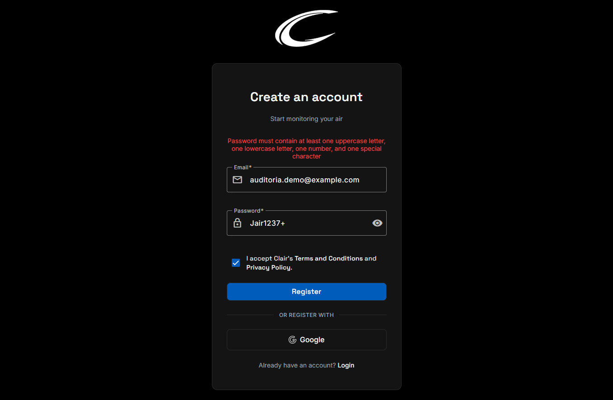
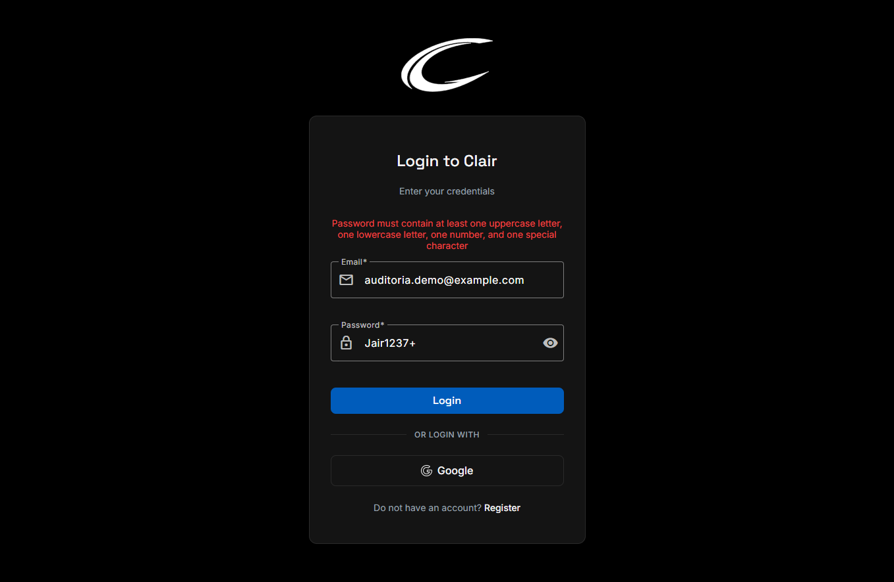

**Recomendación:**
Unificar la regla de contraseña entre frontend y backend. En lugar de una lista cerrada de símbolos, se sugiere aceptar cualquier carácter no alfanumérico (por ejemplo, `[^A-Za-z0-9]`) o una lista amplia que incluya `+ - _ . , ; : ! ?`. En el inicio de sesión no debería ejecutarse la validación de fortaleza: basta con verificar que el campo no esté vacío y dejar la decisión al backend. Finalmente, conviene agregar pruebas unitarias con contraseñas que contengan `+`, `-` y `_`, y mostrar junto al campo cuál requisito específico no se está cumpliendo.

---

**PROBLEMA #2:** La narrativa del producto desplegado no coincide con la del informe y el panel mezcla datos simulados con lecturas reales sin señalizarlo.

**Severidad:** 3
**Heurística violada:** Usability - Consistencia y estándares / Correspondencia entre el sistema y el mundo real.

**Problema:**
La landing pública presenta el producto como "CLAIR NIÑO" con el mensaje "Tu casa te avisa antes que El Niño", centrado en el riesgo de dengue, golpes de calor y humedad en Piura; el informe, en cambio, describe a Clair como una solución de monitoreo de calidad del aire interior en Lima Metropolitana. En la Web App, el panel muestra la etiqueta "EL NIÑO MODE ACTIVE" y la tarjeta "Simulated Scenario: Piura" con 85 % de humedad, 30 °C y riesgo de dengue alto (82), mientras que las tarjetas de contaminantes del mismo panel muestran 25 °C y 56.6 % de humedad, y el índice de calidad del aire indica 70 (moderado). Asimismo, el bloque de alertas indica "No alerts available" pese a que el escenario reporta riesgo alto. No se cuestiona la incorporación del modo El Niño como posible evolución del producto; el hallazgo se centra en que el informe no lo documenta y en que la interfaz no distingue con claridad qué datos son simulados y cuáles provienen de los sensores, lo que puede llevar al usuario a interpretar mal la información.

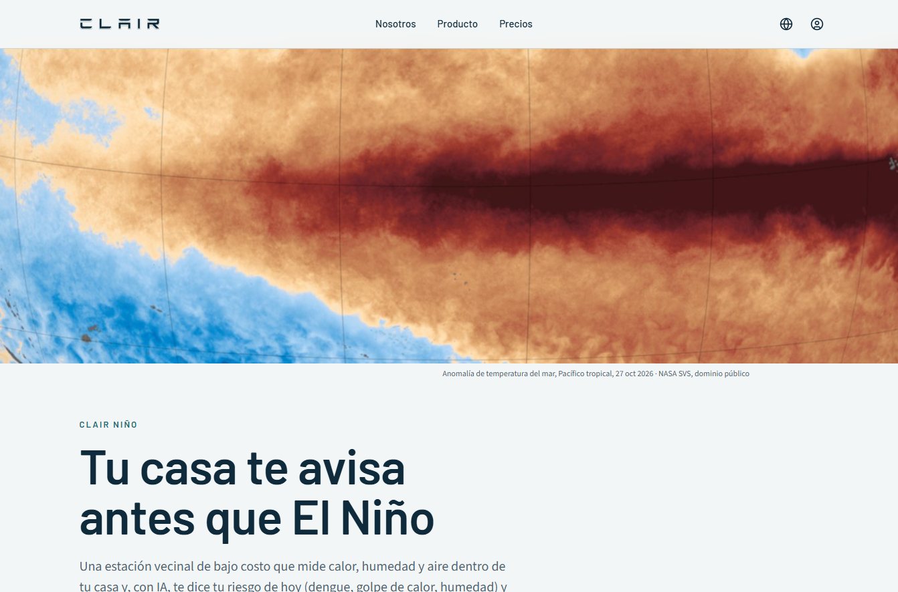
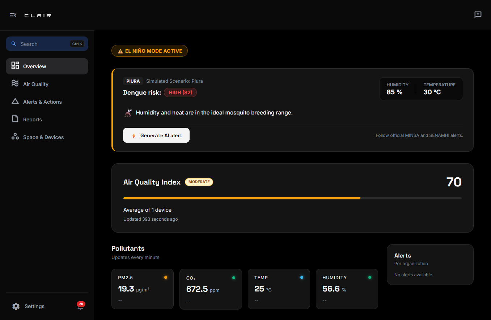

**Recomendación:**
Alinear la narrativa de la landing y del panel con el alcance vigente del producto, o bien documentar formalmente el modo El Niño en el informe y en la propia interfaz. Se recomienda mostrar una etiqueta visible y permanente cuando los datos sean simulados (por ejemplo, "Datos de demostración: escenario Piura"), indicar la fuente y la hora de cada lectura, y reconciliar los valores de la tarjeta de escenario con los de las tarjetas de sensores para que no se contradigan. También sería útil que el bloque de alertas refleje el riesgo alto que anuncia la tarjeta principal.

---

**PROBLEMA #3:** El índice del informe no incluye los capítulos VI, VII y VIII, que sí existen en el repositorio.

**Severidad:** 3
**Heurística violada:** Information Architecture - Is it findable? / Usability - Consistencia y estándares.

**Problema:**
El archivo `content.md`, que funciona como índice general del informe, termina la lista de capítulos en "Capítulo V: Product Implementation" y pasa directamente a "Conclusiones". Sin embargo, el repositorio contiene los archivos `chapter6.md`, `chapter7.md` y `chapter8.md`, y la carpeta `chapters/` los muestra junto a los cinco primeros. Un lector que navegue solo por el índice no encontrará la verificación, validación, el pipeline ni las conclusiones técnicas de los capítulos VI a VIII, por lo que puede interpretar que el informe termina en el capítulo V. Esta situación afecta la navegabilidad y la percepción de completitud del entregable.

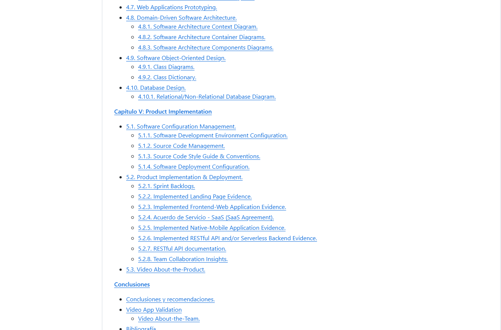
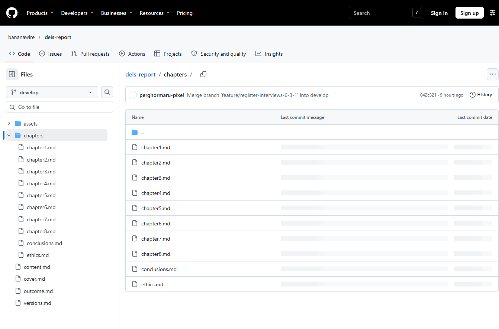

**Recomendación:**
Agregar al índice los capítulos VI, VII y VIII con sus secciones y subsecciones, manteniendo el mismo formato y los mismos anclajes que los capítulos anteriores. Para evitar que vuelva a ocurrir, se sugiere generar el índice de forma automática a partir de los encabezados de los archivos o incluir una verificación en el flujo de integración que compare los archivos de `chapters/` con las entradas de `content.md`.

---

**PROBLEMA #4:** Numeración duplicada en encabezados de los capítulos II y VI (2.1.2 y 6.1.3.1).

**Severidad:** 2
**Heurística violada:** Usability - Consistencia y estándares / Information Architecture - Is it findable?.

**Problema:**
En `chapter2.md`, las líneas 113 y 115 contienen dos encabezados con el mismo número "2.1.2" y títulos casi idénticos ("Estrategias y tácticas frente a competidores." y "Estrategias y tácticas frente a competidores"). En `chapter6.md`, las líneas 728 y 730 repiten el número "6.1.3.1" en "Pruebas Unitarias" y "Core Entities Unit Tests". Además de la inconsistencia visual, la repetición dificulta las referencias cruzadas y los anclajes automáticos del índice, y puede confundir al lector sobre cuál es la sección vigente.

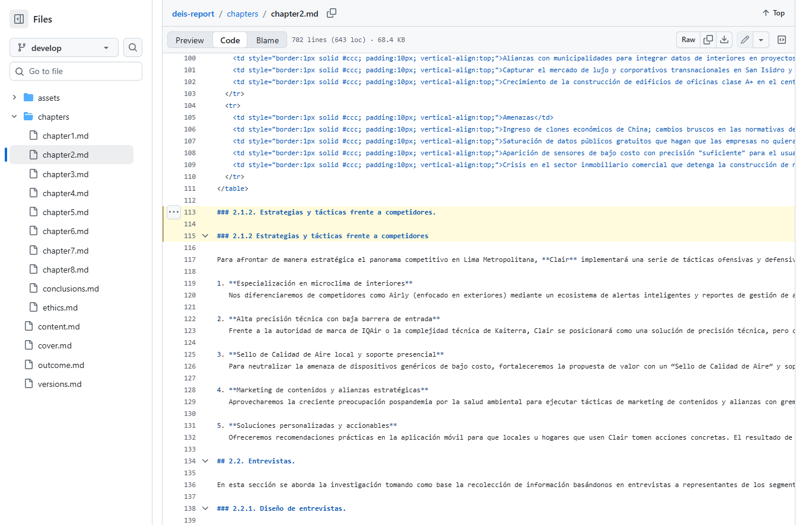
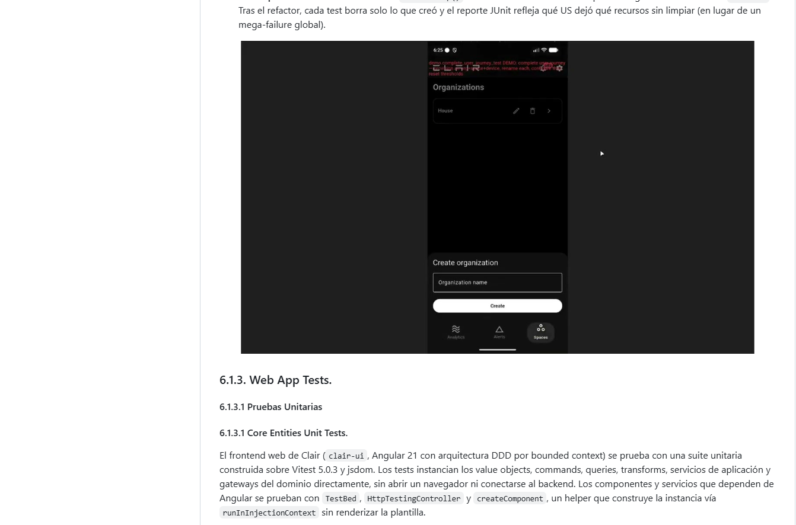

**Recomendación:**
Conservar un único encabezado por sección y renumerar las secciones siguientes cuando sea necesario. Se recomienda incorporar una validación automática (un script propio o una regla de lint de Markdown) que detecte números de sección repetidos y encabezados duplicados antes de publicar el informe.

---

**PROBLEMA #5:** Los canales de contacto no coinciden entre el informe y la landing, y el teléfono publicado es un dato de ejemplo.

**Severidad:** 2
**Heurística violada:** Usability - Consistencia y estándares / Information Architecture - Is it credible?.

**Problema:**
La página de contacto de la landing publica `sales@clair.com` y `support@clair.com`, junto con el teléfono `+51 (0) 123 456 7`, que tiene el formato típico de un dato de ejemplo. Por su parte, el Capítulo V del informe indica como canal de soporte legal `support@clair-iot.com`, un dominio que no resuelve. Los correos publicados usan `clair.com`, un dominio distinto que no se menciona en el informe ni se encuentra asociado al producto. Esta falta de alineación genera dudas sobre cuál es el canal oficial y puede provocar que un usuario interesado no logre comunicarse con el equipo.

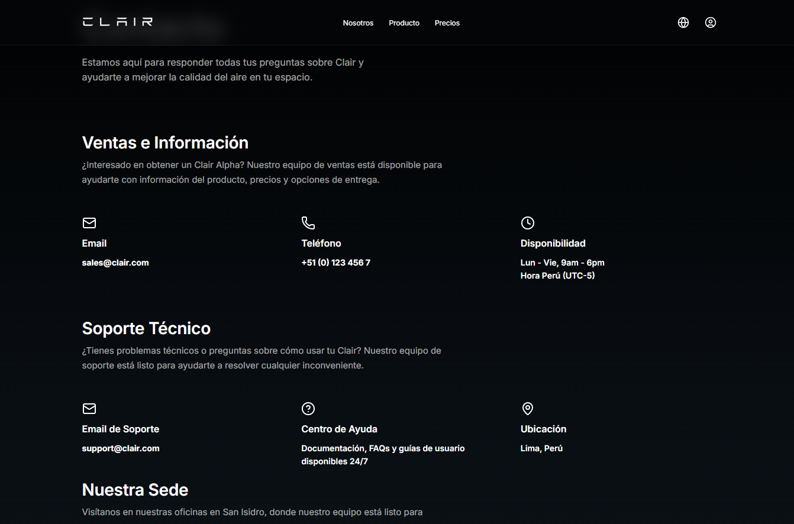

**Recomendación:**
Definir un dominio y un conjunto de correos oficiales, y actualizarlos de forma consistente en la landing, el informe y el Acuerdo de Servicio. Se sugiere reemplazar el teléfono de ejemplo por un número real o retirarlo si aún no está disponible, añadir enlaces `mailto:` en los correos y, idealmente, incluir un formulario de contacto con confirmación de envío para que el usuario sepa que su mensaje fue recibido.

---

**PROBLEMA #6:** Enlaces inconsistentes: la sección del video del equipo apunta al producto y dos anexos comparten la misma URL.

**Severidad:** 2
**Heurística violada:** Information Architecture - Is it findable? / Usability - Consistencia y estándares.

**Problema:**
En `conclusions.md`, la sección "Video About-the-Team." contiene únicamente el enlace "About the Product: https://bit.ly/4olR1cf", por lo que el video del equipo no queda identificado y el lector es dirigido a un contenido distinto al que anuncia el título. En la sección de Anexos, las entradas "Diagramas C4" y "Diagramas de Clases" apuntan a la misma URL (`https://bit.ly/48eogr9`), que redirige al repositorio `bananawire/c4-diagrams`; de este modo, los diagramas de clases no son accesibles desde el enlace que les corresponde. La duplicidad también aparece en otros enlaces de la lista, lo que reduce la confiabilidad de los anexos como fuente de evidencia.

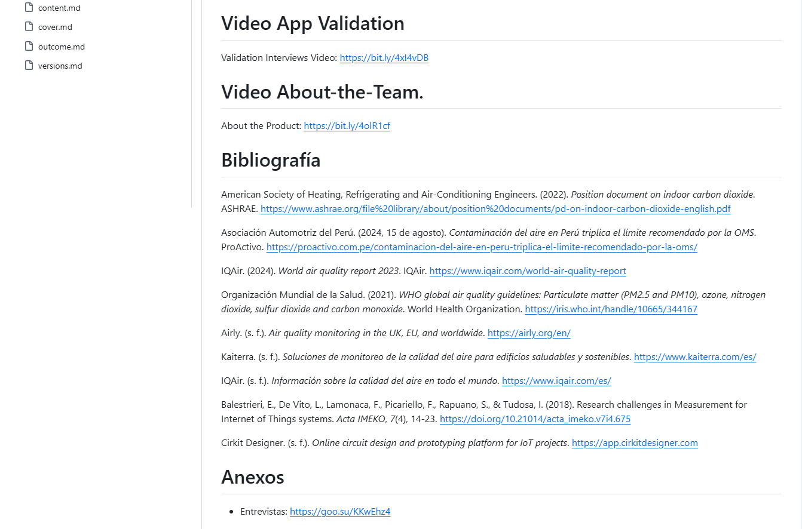
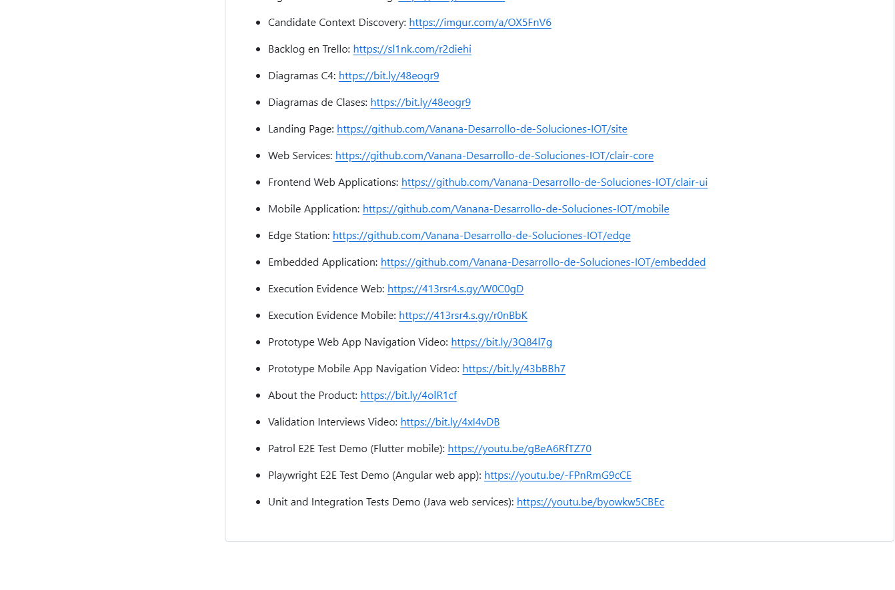

**Recomendación:**
Colocar en "Video About-the-Team." el enlace correcto del video del equipo y mantener "About the Product" en la sección que le corresponde. Asignar a cada anexo una URL única y verificar que el destino coincida con el contenido anunciado; para ello resulta útil ejecutar un verificador de enlaces antes de cada entrega y revisar que no haya entradas repetidas en la lista.

### 6.4.2. Auditoría recibida

#### 6.4.2.1. Información del grupo auditor

| Campo | Detalle |
| :--- | :--- |
| **Nombre de la Startup (Auditora)** | Bananawire |
| **Nombre del Producto (Auditor)** | Clair |
| **Integrante 1** | Aleman Romano, Dante Mateo (u202319963) |
| **Integrante 2** | Barturen, Iker (u202319025) |
| **Integrante 3** | Huaco Oliva, Luis Alonso (u202417743) |
| **Integrante 4** | Ortiz Alarcon, Victor Nicolas (u202312899) |
| **Integrante 5** | Ventosilla Trujillo, Anderson Ricardo (u202319095) |
| **Nombre de la Startup (Auditada)** | HuariApp |
| **Nombre del Producto (Auditado)** | PuntoSabor |
| **Repositorio del Informe Auditado** | https://github.com/HuariApp/puntosabor-report |
| **Repositorio Landing Page** | https://github.com/HuariApp/PuntoSabor-Landing |
| **Repositorio Frontend Web** | https://github.com/HuariApp/PuntoSabor-Front |
| **Repositorio Backend/API** | https://github.com/HuariApp/PuntoSabor-Backend |
| **URL Landing Page** | https://huariapp.github.io/PuntoSabor-Landing/ |
| **URL Frontend Web** | https://punto-sabor-front.vercel.app |
| **URL Backend/Swagger** | https://huariquehub-backend.up.railway.app/swagger |

#### 6.4.2.2. Cronograma de auditoría recibida

| Fecha | Hora Inicio | Hora Fin | Actividad Realizada | Duración | Auditores Participantes |
|:---|:---|:---|:---|:---|:---|
| `[10/11/2026]` | `[12:52]` | `[14:52]` | **Revisión de Landing Page:** Análisis de usabilidad, propuesta de valor, claridad en precios y formulario de contacto. | `[120] min` | `[Luis Huaco]` |
| `[10/11/2026]` | `[13:29]` | `[15:24]` | **Prueba de User Flows (Frontend):** Navegación por la Web App (Búsqueda, mapa, reseñas, login) y evaluación de heurísticas de Nielsen. | `[120] min` | `[Mateo]` |
| `[10/11/2026]` | `[16:00]` | `[18:00]` | **Prueba de Flujos de Dueño (Frontend):** Simulación de registro de huarique, selección de planes y gestión de perfil. | `[120] min` | `[Nicolas]` |
| `[10/11/2026]` | `[17:00]` | `[19:00]` | **Revisión de Acuerdo de Servicio (SaaS):** Análisis de claridad legal, políticas de cancelación y transparencia de precios. | `[120] min` | `[Anderson]` |
| `[10/11/2026]` | `[20:00]` | `[23:00]` | **Consolidación de hallazgos:** Redacción del documento de auditoría, asignación de severidades y propuestas de mitigación (Anexo D). | `[180] min` | `[Iker]` |

#### 6.4.2.3. Contenido de auditoría recibida

#### Anexo D. Formato para Evaluación de User Experience según Heurísticas

**UX Heuristics & Principles Evaluation**
**Usability – Inclusive Design – Information Architecture**

| | |
| :--- |:--- |
| **CARRERA** | Ingeniería de Software |
| **CURSO** | Diseño de Experimentos de Ingeniería de Software |
| **NRC** | `[9112]` |
| **PROFESORES** | Cenas Vasquez, Lennin Percy / Flores Morocco, Juan Antonio / Noriega Melendez, Julio Manuel / Sanchez Ponce, Alex Humberto / Yesn Paiba, Juan Fernando |
| **AUDITOR** | Bananawire / Clair (Equipo auditor) |
| **CLIENTE(S)** | HuariApp / PuntoSabor (Equipo auditado) |

**SITE o APP A EVALUAR:**
PuntoSabor (Landing Page, Web Application y Mobile Application).

**TAREAS A EVALUAR:**

El alcance de esta evaluación incluye la revisión de la usabilidad de las siguientes tareas (basadas en los User Flows del equipo auditado):

1. Iniciar sesión y registrarse como Explorador.
2. Búsqueda y filtrado de huariques por categoría y precio (Explore).
3. Visualización de huariques en el mapa e interacción con los marcadores.
4. Publicación de una reseña y calificación en un huarique.
5. Registro de un nuevo huarique (flujo para Dueños).
6. Visualización y selección de planes de membresía (Basic, Premium, Exclusive).
7. Guardar un huarique en la lista de favoritos.
8. Enviar un mensaje a través del formulario de contacto (Landing Page).

No están incluidas en esta versión de la evaluación las siguientes tareas:

1. Flujo de pago real de membresía con pasarela externa (Stripe/Niubiz).
2. Recuperación de contraseña vía correo electrónico.
3. Módulo de notificaciones push en tiempo real (debido a que requiere configuración del dispositivo).
4. Panel de administración avanzado o estadísticas para el Dueño del huarique.

**ESCALA DE SEVERIDAD:**

Los errores serán puntuados tomando en cuenta la siguiente escala de severidad:

| Nivel | Descripción |
| :---: | :--- |
| **1** | **Problema superficial:** puede ser fácilmente superado por el usuario u ocurre con muy poca frecuencia. No necesita ser arreglado a no ser que exista disponibilidad de tiempo. |
| **2** | **Problema menor:** puede ocurrir un poco más frecuentemente o es un poco más difícil de superar para el usuario. Se le debería asignar una prioridad baja resolverlo de cara al siguiente release. |
| **3** | **Problema mayor:** ocurre frecuentemente o los usuarios no son capaces de resolverlos. Es importante que sean corregidos y se les debe asignar una prioridad alta. |
| **4** | **Problema muy grave:** un error de gran impacto que impide al usuario continuar con el uso de la herramienta. Es imperativo que sea corregido antes del lanzamiento. |

**TABLA RESUMEN:**

| # | Problema | Escala de severidad | Heurística/Principio violada(o) |
| :---: | :--- | :---: | :--- |
| 1 | Falta de feedback visual inmediato al intentar publicar una reseña duplicada o con errores de validación. | 3 | Usability: Prevención de errores / Visibilidad del estado del sistema |
| 2 | El popup del mapa (Explore) muestra información básica, pero no incluye un botón de acción rápida para "Cómo llegar" (integración con Google Maps/Waze). | 3 | Information Architecture: Is it useful? / Usability: Flexibilidad y eficiencia de uso |
| 3 | El formulario de registro de huarique para los dueños presenta múltiples campos obligatorios sin guardado automático, lo que puede causar pérdida de datos. | 3 | Usability: Libertad y control del usuario |
| 4 | La transición entre el rol de "Explorador" y "Dueño" dentro de la misma cuenta no es evidente en la navegación principal. | 2 | Usability: Consistencia y estándares |
| 5 | En la Landing Page, los precios de las membresías (Básico, Premium, Exclusivo) se muestran, pero los detalles sobre cómo se procesa el pago o si hay contratos de permanencia no son explícitos. | 2 | Information Architecture: Is it findable? |

---

**DESCRIPCIÓN DE PROBLEMAS:**

**PROBLEMA #1:** Falta de feedback visual inmediato al intentar publicar una reseña duplicada o con errores de validación.

**Severidad:** 3
**Heurística violada:** Usability - Prevención de errores / Visibilidad del estado del sistema.

**Problema:**
En la User Story US07 ("Publicar reseñas"), el sistema establece que un usuario no puede publicar más de una reseña para el mismo huarique. Sin embargo, en la interfaz evaluada, si el usuario ya reseñó el local o deja campos vacíos, el sistema no muestra un mensaje de error claro o un estado visual que indique por qué la acción está bloqueada. El botón de "Publicar" simplemente no responde o recarga la página, lo que genera confusión y frustración en el explorador gastronómico.

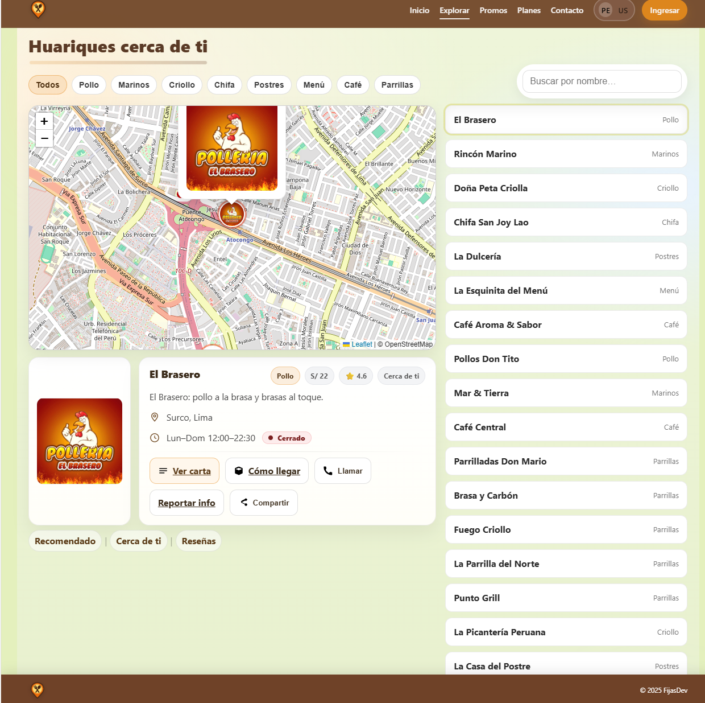

**Recomendación:**
Implementar validaciones en línea (inline validation). Si el usuario ya dejó una reseña, el formulario debe ocultarse y reemplazarse por un mensaje como "Ya has calificado este huarique". Si faltan campos, el botón debe deshabilitarse o mostrar un texto en rojo indicando exactamente qué campo falta (ej. "Por favor, escribe un comentario antes de enviar").

---

**PROBLEMA #2:** El popup del mapa (Explore) muestra información básica, pero no incluye un botón de acción rápida para "Cómo llegar".

**Severidad:** 3
**Heurística violada:** Information Architecture - Is it useful? / Usability - Flexibilidad y eficiencia de uso.

**Problema:**
En el flujo de "Visualizar huariques en mapa" (US02), al hacer clic en el marcador de un huarique, aparece un popup flotante con el nombre, dirección y calificación. Sin embargo, para un explorador cuya principal motivación es visitar el lugar (según el User Persona de Carla Dípes), el flujo se interrumpe, ya que debe copiar la dirección manualmente y abrir otra aplicación. La falta de un botón directo que abra la ruta en Google Maps o Waze añade fricción al "happy path" del usuario.

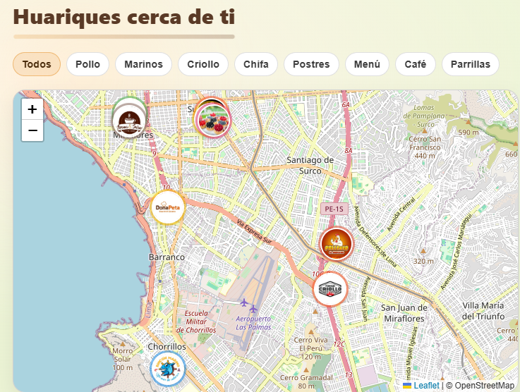

**Recomendación:**
Agregar un botón principal o un ícono de "Ruta" dentro del popup del marcador. Al hacer clic, debe abrir una nueva pestaña o la app nativa de mapas con la latitud y longitud del huarique ya configuradas. Esto reduce la carga cognitiva y agiliza el proceso de visita.

---

**PROBLEMA #3:** El formulario de registro de huarique para los dueños presenta múltiples campos obligatorios sin guardado automático.

**Severidad:** 3
**Heurística violada:** Usability - Libertad y control del usuario.

**Problema:**
El User Persona del dueño (Don Luis) representa a un emprendedor con restricciones tecnológicas. En el flujo de "Registrar un nuevo huarique" (US04), el formulario solicita nombre, categoría, dirección, distrito, rango de precios, horarios, descripción y fotos. Si el dueño se distrae o su conexión a internet falla a mitad del proceso, al regresar perderá todo el progreso. No hay un mecanismo de "borrador" ni una forma fácil de regresar sin salir del formulario por completo.

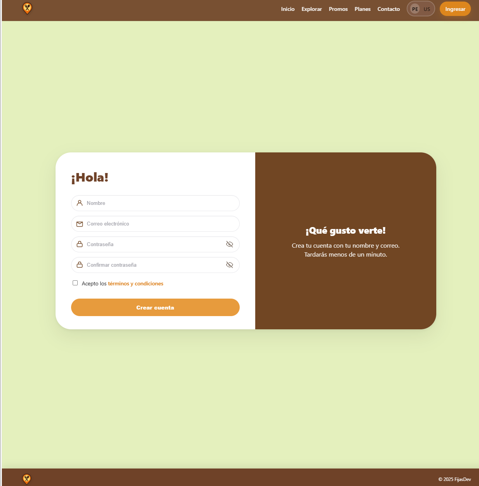

**Recomendación:**
Dividir el formulario en un proceso "Paso a Paso" (Wizard) de máximo 3 pasos (Información Básica, Horarios/Ubicación, Fotos). Además, implementar un guardado automático temporal en el `localStorage` o en la base de datos, de modo que si el usuario sale o recarga, pueda retomar donde lo dejó.

---

**PROBLEMA #4:** La transición entre el rol de "Explorador" y "Dueño" dentro de la misma cuenta no es evidente.

**Severidad:** 2
**Heurística violada:** Usability - Consistencia y estándares.

**Problema:**
El backend de PuntoSabor permite que un mismo usuario (a través de la entidad `User` con el campo `Role`) pueda ser explorador o dueño. Sin embargo, en la interfaz web y móvil, la navegación está diseñada como si el usuario fuera uno u otro. Si un usuario que exploró huariques decide registrar su propio negocio, no hay un botón claro en el menú de perfil que diga "Convertirme en Dueño" o "Panel de Propietario", lo que obliga al usuario a buscar opciones ocultas o registrarse de nuevo.

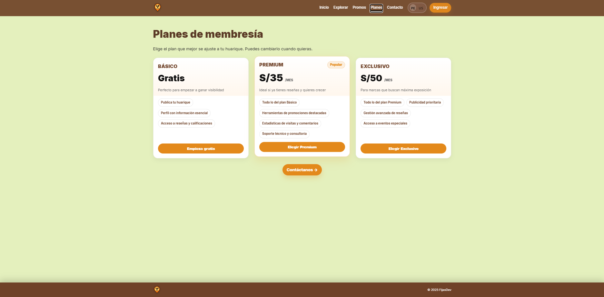

**Recomendación:**
Añadir un "Toggle" (interruptor) o un botón en el menú de perfil (como "Modo Dueño") que permita al usuario alternar la vista de la aplicación. Si no tiene un huarique registrado, este botón debe llevarlo al flujo de registro (US04). Si ya lo tiene, debe llevarlo a su panel de gestión.

---

**PROBLEMA #5:** En la Landing Page, los precios de las membresías se muestran, pero la letra pequeña sobre la cancelación o el procesamiento de pagos no es explícita.

**Severidad:** 2
**Heurística violada:** Information Architecture - Is it findable?

**Problema:**
El Acuerdo de Servicio (sección 5.2.4) detalla claramente que los dueños pueden cancelar su membresía en cualquier momento y que no hay reembolsos, pero en la sección de precios de la Landing Page solo se muestran los montos ($35 y $50) y los beneficios. Para generar confianza (especialmente en microempresarios que rechazan comisiones abusivas), la información sobre la facilidad para cancelar o la ausencia de contratos forzosos debe estar visible antes de hacer clic en "Empezar".

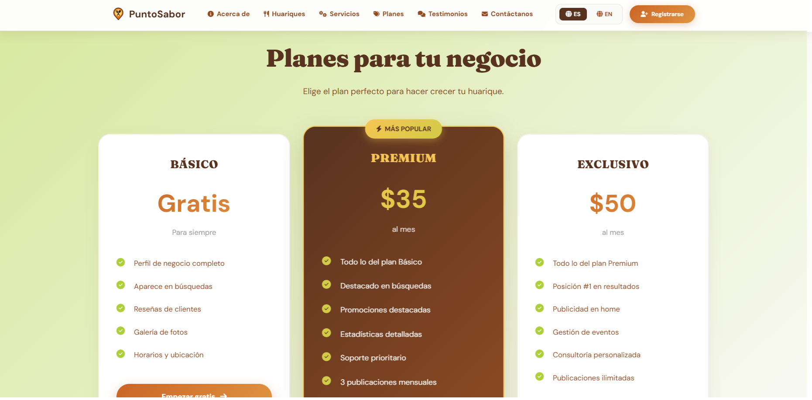

**Recomendación:**
Añadir un texto corto debajo de los botones de pago de los planes que diga: "Cancela en cualquier momento. Sin contratos forzosos". También se puede agregar un enlace directo al apartado de "Política de Cancelación" del Acuerdo de Servicio.

---

#### 6.4.2.4. Resumen de modificaciones para subsanar hallazgos

| # | Hallazgo | Modificación propuesta | Impacto esperado | Prioridad |
| :---: | :--- | :--- | :--- | :---: |
| 1 | Falta de feedback en reseñas | Implementar validaciones en línea y reemplazar el formulario por un mensaje claro cuando el usuario ya haya reseñado el huarique. | Menos frustración y mayor claridad sobre el estado de la publicación. | Alta |
| 2 | Popup del mapa sin acción rápida | Agregar un botón "Cómo llegar" que abra Google Maps o Waze con las coordenadas del huarique. | Un recorrido más corto y útil para el explorador. | Alta |
| 3 | Formulario de huarique sin guardado automático | Convertir el registro en un asistente de tres pasos y guardar un borrador temporal. | Se evita la pérdida de datos y se reduce la carga del dueño. | Alta |
| 4 | Transición de rol poco evidente | Incorporar un botón o interruptor "Modo Dueño" en el menú de perfil. | Mayor facilidad para convertirse en dueño y gestionar el negocio. | Media |
| 5 | Precios sin condiciones de cancelación | Añadir el texto "Cancela en cualquier momento. Sin contratos forzosos" y un enlace a la política de cancelación. | Mayor transparencia y confianza antes de elegir un plan. | Media |

Los cinco hallazgos son oportunidades de mejora que no comprometen la propuesta de valor de PuntoSabor. Se recomienda priorizar los hallazgos 1, 2 y 3 por su impacto directo en la confianza y en la continuidad del flujo del usuario, y abordar los hallazgos 4 y 5 en el siguiente release. La implementación de estas modificaciones permitirá que la experiencia de PuntoSabor sea más clara, segura y consistente con lo documentado en el informe.

# Capítulo VII: DevOps Practices

## 7.1. Continuous Integration

### 7.1.1. Tools and Practices

### 7.1.2. Build & Test Suite Pipeline Components

## 7.2. Continuous Delivery

### 7.2.1. Tools and Practices

### 7.2.2. Stages Deployment Pipeline Components

## 7.3. Continuous deployment

### 7.3.1. Tools and Practices

### 7.3.2. Production Deployment Pipeline Components

## 7.4. Continuous Monitoring

### 7.4.1. Tools and Practices

### 7.4.2. Monitoring Pipeline Components

### 7.4.3. Alerting Pipeline Components

### 7.4.4. Notification Pipeline Components

# Capítulo VIII: Experiment-Driven Development

## 8.1. Experiment Planning

### 8.1.1. As-Is Summary

### 8.1.2. Raw Material: Assumptions, Knowledge Gaps, Ideas, Claims

### 8.1.3. Experiment-Ready Questions

### 8.1.4. Question Backlog

### 8.1.5. Experiment Cards

## 8.2. Experiment Design

### 8.2.1. Hypotheses

### 8.2.2. Domain Business Metrics

### 8.2.3. Measures

### 8.2.4. Conditions

### 8.2.5. Scale Calculations and Decisions

### 8.2.6. Methods Selection

### 8.2.7. Data Analytics: Goals, KPIs and Metrics Selection

### 8.2.8. Web and Mobile Tracking Plan

## 8.3. Experimentation

### 8.3.1. To-Be User Stories

### 8.3.2. To-Be Product Backlog

### 8.3.3. Pipeline-supported, Experiment-Driven To-Be Software Platform Lifecycle

#### 8.3.3.1. To-Be Sprint Backlogs

#### 8.3.3.2. Implemented To-Be Landing Page Evidence

#### 8.3.3.3. Implemented To-Be Frontend-Web Application Evidence

#### 8.3.3.4. Implemented To-Be Native-Mobile Application Evidence

#### 8.3.3.5. Implemented To-Be RESTful API and/or Serverless Backend Evidence

#### 8.3.3.6. Team Collaboration Insights

### Matriz de Evaluación Ética y de Impacto

### 8.3.4. To-Be Validation Interviews

#### 8.3.4.1. Diseño de Entrevistas

#### 8.3.4.2. Registro de Entrevistas

## 8.4. Experiment Aftermath & Analysis

### 8.4.1. Analysis and Interpretation of Results

### 8.4.2. Re-scored and Re-prioritized Question Backlog

## 8.5. Continuous Learning

### 8.5.1. Shareback Session Artifacts: Learning Workflow

## 8.6. To-Be Software Platform Pre-launch

### 8.6.1. About-the-Product Intro Video

### 8.6.2. Resumen usando Gees FrameWork

## Conclusiones

## Bibliografía

## Anexos
